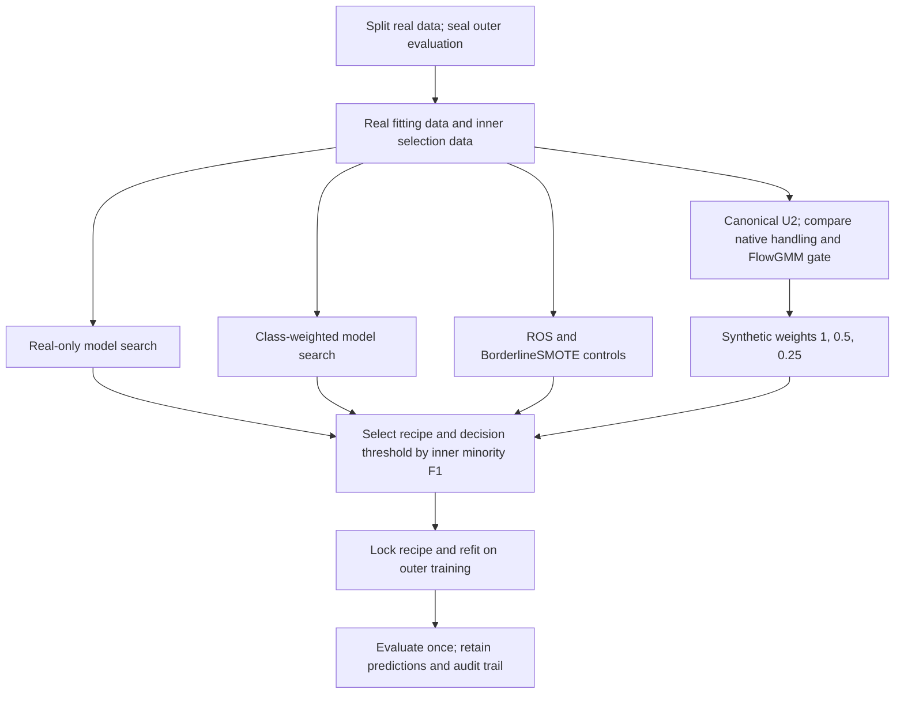

# Phase 1 — final pipeline proposal

## Recommendation

**Optimize minority-class F1, not AP. Start with LightGBM and canonical U2, keep the FlowGMM gate optional, and select both synthetic weight and the classifier decision threshold on real validation F1.** Do not make downweighting or stricter filtering mandatory because they improved AP.

The practical recipe selector must also admit real-only, class-weighted, ROS and BorderlineSMOTE models. LightGBM is the recommended starting learner based on the recorded Shoppers F1 results, not an established cross-dataset winner. RF and native MLP remain supported alternatives; LR remains a useful control.

This is a **draft for the user's final decision**, not an implementation or retention-policy change. It uses only Phase 1 material outside `PLAN2/`; root `PLAN2.md` and PLAN3 were excluded. No new study is required by this proposal.

**Naming:** “F1 score” means positive/minority-class binary F1, not macro F1, support-weighted F1 or the SOS inverse-support metric. “FlowGMM gate” means the component historically named F1. Current U5 means U2 alone; historical U5(+F1) can contain U1 OOF scoring. Do not relabel historical results as current pure-U2 measurements. [Current semantics](../PLAN.MD#stage-1--ugo-pipeline), [latest provenance](downweight.md#scope-and-verified-evidence).

## 1. What the F1 results actually support

The latest matched downweighting study reports the following five-seed mean **minority F1 at classifier threshold 0.5**. Its learner settings and downweights were selected for AP, not F1:

| Classifier | U2, weight 1 | U2 + FlowGMM gate, weight 1 | U2 + gate, AP-selected weight 0.25/0.5 | Matched real-only |
|---|---:|---:|---:|---:|
| Logistic regression | 0.548157 | 0.527201 | 0.494049 | 0.472474 |
| Random forest | 0.652711 | 0.655752 | 0.656516 | 0.653941 |
| LightGBM | 0.657688 | 0.658961 | 0.660790 | 0.647250 |
| Native MLP | 0.627887 | 0.628423 | 0.623295 | 0.611296 |

Source: [all recorded metrics](downweight.md#all-24-metrics-mean--sample-seed-sd), [saved metric summary](../results/runs/20261012T120400-c73514825f95/independent_report.all_metrics_summary.csv).

This changes the earlier AP-first interpretation:

- Real-only AP superiority does **not** establish real-only F1 superiority. In this table, both unit-weight augmentation recipes exceed matched real-only F1 in LR/LightGBM/MLP; gated augmentation also exceeds it in RF.
- Downweighting is **not a reliable F1 improvement**. In the gated branch, AP-selected weights improve tree F1 slightly but reduce LR and MLP F1. All twelve downweighted family/classifier comparisons reduce recall, but their F1 changes have mixed signs.
- Keep synthetic weight **1** in the candidate grid. Do not reuse an AP-selected 0.25/0.5 coefficient as the F1-optimal choice.
- In the earlier controlled study, LightGBM + BorderlineSMOTE achieved mean minority F1 **0.6728**, versus **0.6683** with ROS. RF + BorderlineSMOTE reached **0.6606**. These are important simple competitors, not proof of a universal winner: settings, tuning and study provenance differ from the latest table. [Completed controls](reproduction.md#phase-1-shoppers-controls--user-review-pending).
- Every quoted value above uses threshold 0.5. These results do **not** identify the best method after validation-based threshold selection. The highest test F1 must never determine a threshold or a winning recipe.

The main bounded addition is therefore **F1-directed model and threshold selection**, not another generator. The complete recipe selector, and the effect of threshold tuning in isolation, remain unevaluated.

**Subsequent requested cross-dataset comparison:** [U2 + FlowGMM versus original UGO](../results/runs/climb-flow-f1-20261020T152022Z-4506435a/RESULTS.md) completed all 120 cells on five CLIMB datasets, native MLP/LR/XGBoost/RF and three split seeds, with F1-based selection and classifier thresholds for both methods. Gated U2 improves equal-dataset mean F1 for MLP/LR/RF but worsens XGBoost; dataset-level signs are mixed. This measures the two complete recipes, not the gate in isolation, and includes neither LightGBM nor the full real-only/weighting/simple-resampling selector proposed below. It does not establish a universal replacement or automatically change retention.

## 2. Final pipeline contract

### Data roles and isolation

- Split raw real observations before fitting preprocessing, groups, support rules or learned components. Preserve natural evaluation prevalence and any entity/time boundaries.
- Fit classifier imputation, scaling and encoding on real fitting rows only. Synthetic observations never fit preprocessing or become support references, anchors or partners.
- Use real inner validation for all recipe choices. It is selection feedback, not independent performance evidence. After choices freeze, the final classifier/preprocessor may refit on full outer training, including former validation rows.
- For the **FlowGMM gate**, preserve the tested special rule: fit its private preprocessing and detector on a stratified 80% of real inner-fit rows; reserve the remaining 20% unused by compatibility-only gating. Exclude inner validation and outer test from detector fitting. Freeze that detector through generation **and outer replay**, bridging classifier coordinates back to detector coordinates. Do not silently refit it on full outer training.
- On a genuinely new outer partition, rebuild all training-derived objects within that partition. Do not reuse Shoppers-specific learned weights or selected thresholds as universal constants.

Sources: [experimental contract](../PLAN.MD#experimental-contract), [F1 protocol](../configs/ablations/stage1_f1.yaml), [latest native-fit roles](downweight.md#scope-and-verified-evidence).

### Exact augmented-branch design

| Component | Final proposed choice |
|---|---|
| Real support | Existing corrected real-only pre-generation eligibility rule; keep all real observations available to downstream classifier fitting. No synthetic self-support. |
| Anchor difficulty | Current native classifier's true-label MMA, refreshed after augmented retraining. No U1 OOF composition or LR surrogate. Call it difficulty, not epistemic uncertainty. |
| Minority groups | Canonical real-only KMeans/stability U2: eight clusters capped by distinct coordinates; five 80% real-row subsamples for co-membership stability. |
| Allocation | Stability-adjusted weight `r_g (h_g + 0.001) / (n_g + 0.001)^alpha`; `alpha ∈ {0, 0.5, 1}`. Saturated largest-remainder quotas; unsupported/single-coordinate/zero-stability groups receive none. |
| Lifetime caps | `floor(2*n_g)` accepted descendants per source group; at most four per real anchor. Top-half eligible difficulty selection within each group. Synthetic rows never enlarge support or caps. |
| Proposal | Existing input-space interpolation between eligible, distinct, same-class real parents; copy whole categorical values from the real partner. U2 groups govern source allocation, **not partner restriction**. No latent interpolation or conditional inpainting. |
| Post-generation handling | Compare native U2 neighbor detection/relocation with the retained compatibility-only FlowGMM gate. The gate uses original proposals and `log p(x|y) − log p(x|other) ≥ logit(tau)`, equal class priors, and the retained deterministic one-hot/dequantization convention. |
| Rejection | In the gated arm, replace both neighbor post-detection and relocation; no F2 likelihood cutoff, rescue, quota refill or padding. Existing finite/domain checks remain separate. The ungated comparator is actual native U2, not a fictitious “off” value of tau. |
| Training influence | Real weight 1; synthetic weight selected from `{1, 0.5, 0.25}` using threshold-optimized validation minority F1. Apply the weight to all accumulated accepted synthetic rows at every retrain; each weight follows its own native trajectory. |
| Native fitting | LR, RF, LightGBM and native MLP use their actual weighted estimators. No surrogate downstream learner. Preserve native loss normalization and regularization; MLP uses weighted-mean CE and fixed epochs, not validation-driven early stopping. |
| Retraining/stopping | Keep existing U2 cadence and Welch stopping, with the declared 20-round ceiling and 1,000 original-proposal cap for the Shoppers recipe. Stop explicitly on no eligible capacity/all rejection; do not retrain unchanged data. No U4 checkpoint/budget search. |

Sources: [U2 definition and quotas](../README.md#u2-group-protectionallocation--user-retained), [mechanisms](technical_changes.md), [F1 implementation contract](f1.md#scope-and-evidence), [downweighting configuration](../configs/ablations/stage1_downweight.yaml).

F1 remains the pinned `flowgmm_tabular_v1` shared RealNVP with class-associated diagonal Gaussian components: six coupling layers, two width-64 hidden layers, 60 epochs, batch 256, Adam learning rate 0.001, balanced real-only likelihood fitting. Do not retune its architecture in the closure step. Its likelihood ratio is model-based compatibility, not absolute support or label correctness.

**Validity boundary:** the retained interpolation recipe is not the stricter schema/count-decoding intervention used in the TabDiff study. In particular, historical interpolated counts can remain continuous. Do not claim it enforces all original integer/count-duration semantics, or silently import the TabDiff decoder into the frozen baseline. [F1 mixed-data convention](f1.md#scope-and-evidence), [TabDiff-specific controls](tabdiff.md#validity-counts-and-duplicates).

### F1-first model, gate, weight and threshold selection

This is a **proposed selection protocol**, not the AP-selected historical experiment relabeled as an F1 experiment.

1. Keep a finite recipe set: real-only, class-weighted real-only, ROS, BorderlineSMOTE, native U2, and U2 + FlowGMM gate. Do not silently combine class weighting with resampling. Apply the same threshold-selection opportunity to every recipe.
2. Retain the ten learner proposals for applicable searches. For U2, cycle `alpha ∈ {0, 0.5, 1}` across those joint proposals. Select canonical learner/alpha settings at synthetic weight 1 by **best validation minority F1 over decision thresholds**, not AP. Lock those settings for the two U2 handling recipes.
3. For the gated recipe, compare `tau ∈ {0.5, 0.6, 0.7, 0.8}` at unit synthetic weight, scoring each by threshold-optimized validation F1; lock the chosen tau. This is fresh F1-based selection, not reuse of an AP-selected historical tau. The frozen detector architecture/data roles remain unchanged.
4. Within each U2 handling recipe, compare synthetic weights `{1, 0.5, 0.25}`. Refit each complete trajectory and select its own classifier decision threshold before comparing validation F1. Exact weight ties prefer 1, then 0.5, then 0.25. There is no presumption that downweighting helps.
5. Compare the resulting complete recipes by validation F1. Exact recipe ties prefer real-only, class-weighted real-only, ROS, BorderlineSMOTE, native U2, then gated U2. Freeze the recipe, all model/generation settings and its threshold before outer refitting/evaluation. The final threshold is replayed unchanged; never re-optimize it on outer test or on validation rows after they enter full-training refitting.
6. Report all native fits, gate/weight searches and threshold-selection costs. Equal learner proposals do **not** mean equal compute. The same validation set is used for selection, so its maximum F1 is optimistically selected feedback, not independent performance evidence.

For held-out validation probabilities, use

$$
\hat y_i(t)=\mathbf 1[p_i\ge t],\qquad
F_1(t)=\frac{2TP(t)}{2TP(t)+FP(t)+FN(t)},\qquad
t^*=\arg\max_t F_1(t).
$$

Evaluate the distinct prediction sets induced by validation scores, including all-positive/all-negative endpoints. Process tied scores together. On exact threshold ties, choose the candidate closest to 0.5, then the larger threshold; return F1=0 for a zero denominator. Use natural validation prevalence, not resampled or class-balanced validation rows. **The classifier threshold `t` and FlowGMM compatibility threshold `tau` are different parameters.** Do not substitute `t=F1/2`; that shortcut needs calibration assumptions not established here.

After selection, refit on real outer training plus the selected augmentation and retain `t*`. Refitting can shift score distributions; threshold transfer must be evaluated on untouched outer data, not assumed perfect. All previous 0.5-threshold metrics remain historical context. AP is a secondary ranking diagnostic and never overrides a lower validation F1.

This does **not** restore discarded U4: no intermediate checkpoint or budget-fraction search is introduced. No new generator, ensemble or exploratory run is required to close Phase 1.

## 3. Disposition of the other methods

These are **recommendations for the final draft**, not rewritten historical user decisions.

| Method | Final disposition and reason |
|---|---|
| U1 OOF / historical U1+U2(+F1) | Preserve evidence and standalone retention history, but do not compose into current U2. The user later defined the current candidate as U2 alone. |
| U3, U4, H1, F2 | Keep excluded as already discarded; no restoration of geometric repairs, checkpoint-budget selection, HDBSCAN support or absolute likelihood filtering. |
| Gradient-utility K5 | Leave discarded. Local gradient accuracy did not establish downstream F1 improvement; the RF AP gain was accompanied by slightly lower F1/MCC, and LightGBM lost F1 in all five seeds. Tree scores use an LR surrogate. [Utility evidence](validation_guided.md), [separate-guidance evidence](learning_benefit.md). |
| Pool-random / pool-random+F1 | Omit from the default recipe. In the recorded pool study, adding the gate reduces mean minority F1 in all three classifiers despite some AP gains. Plain random-pool remains a comparator, not a necessary extra stage. [Pool results](pool_random_f1.md). |
| Within-group Flow interpolation | Do not adopt. Mean F1 changes against matched input interpolation are small/mixed: LR 0.549727→0.544383, RF 0.652931→0.654100, LightGBM 0.662953→0.655846; 62.2% of outer proposals are ineligible. Tree AP gains are not the requested objective. Flow+gate was not tested. [Geometry report](flow_geometry.md). |
| TabDiff, with or without gate | Archive as research evidence, not the F1-first default. The with-gate AP-selected LR result lowers minority F1; no-F1 tree selected F1 also declines. Fixed-round studies do not establish an iterative replacement, and generator fitting took about 6.48 hours. [With gate](tabdiff.md), [without gate](tabdiff_u2.md). |
| Bagging, committees, new support filters/generators | Do not add. No closure-blocking experiment or combinatorial extension sweep. Bagging remains deferred. |

No additional new learning method is needed. Threshold selection and replacing AP-based selection with minority F1 are the useful bounded changes. Existing SMOTE/SMOTENC, original/corrected UGO and balanced RF remain evaluation controls, not internal pipeline stages; ROS and BorderlineSMOTE join the selectable shortlist because they are competitive simple F1 recipes. Preserve KMeansSMOTE's nine failed cells rather than treating two-seed means as complete evidence.

## 4. Objective, evidence and freeze boundary

- **Selection objective:** minority-class binary F1 throughout learner, recipe, gate, synthetic-weight and classifier-threshold selection. Do not fix the classifier threshold to 0.5 merely for historical continuity. Do not substitute AP, recall alone, accuracy, weighted F1 or the Shoppers diagnostic `10 FP + 500 FN` for the user's objective.
- **Reports:** lead with untouched-test minority F1 at the frozen validation-selected threshold, plus precision, recall, TP/FP/FN and threshold. Retain historical-threshold F1 and AP/CE/MCC as secondary diagnostics; distinguish descriptive ROC operating points from deployable validation-selected thresholds.
- **Dose and mechanism:** log physical proposals, charged attempts, accepted rows, added synthetic weight, group/anchor coverage, duplicates, actual native fits and all termination/underspend reasons. A common cap is not matched accepted dose or effective weight. Do not claim that F1's benefit is causally separated from thinning.
- **Uncertainty:** five development seeds share one Shoppers holdout. Seed SD and paired row/seed bootstrap intervals are conditional development evidence, not independent-fold confirmation. Separate guidance-split, full-access iterative, fixed-round TabDiff and legacy benchmark protocols. The notebook's single-seed 2D visualizations are illustrative, not new confirmation.
- **Scope:** Shoppers-specific numerical budgets and the binary FlowGMM gate do not establish a validated multiclass or cross-dataset recipe. Confirmatory datasets must be genuinely untouched; Shoppers overlap inside another suite is not independent evidence.

**Close Phase 1 by approving or amending this finite manifest, not by requiring more exploratory runs.** Record the final component decisions, explicit method names, grids, objectives, data roles, budgets, software/config hashes and provenance in a new freeze record. Preserve historical evidence unchanged. This draft does not flip existing `not_frozen` policies or open CLIMB/Stage 2 automatically.

Closure can honestly mean **the F1-first design is frozen for subsequent evaluation**. Historical Shoppers results are AP-selected and mostly fixed-threshold; the subsequent five-dataset F1-selected study compares only gated U2 with original UGO. Neither establishes a winner for the complete selector proposed here or promises a particular F1 gain. Generation's added value must be judged against equally F1-tuned real-only, weighting and simple-resampling controls, not inferred from AP or a privileged threshold.
